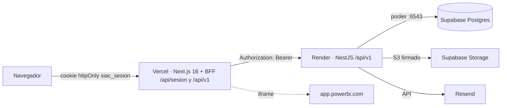

# Despliegue SIAC: Supabase + Render + Vercel

> Sprint 3 · Despliegue de verificación fuera de los equipos locales.
> Arquitectura: **navegador → Vercel (Next.js + BFF) → Render (NestJS) → Supabase (Postgres + Storage S3)**.
> Ningún secreto se versiona: los valores se escriben solo en los paneles de cada servicio.



## 0. Orden obligatorio

1. **Supabase**: proyecto, buckets y cadenas de conexión.
2. **Render**: backend (aplica las migraciones al arrancar). Anotar la URL `https://<servicio>.onrender.com`.
3. **Vercel**: frontend apuntando a Render. Anotar la URL `https://<proyecto>.vercel.app`.
4. **Volver a Render** y actualizar `CORS_ORIGENES` y `FRONTEND_URL` con el dominio de Vercel (redeploy).

## 1. Supabase

1. Crear (o reutilizar) el proyecto. Región sugerida: la misma zona que Render (`us-east-1` / `ca-central-1` ↔ Render `virginia`).
2. **Database → Connect** y copiar dos cadenas del **pooler compartido (Supavisor)**. Render solo tiene IPv4 y el host directo `db.<ref>.supabase.co` es IPv6, así que **no** se usa la conexión directa salvo que se compre el add-on IPv4:
   - `DATABASE_URL` (app, modo transacción, puerto **6543**):
     `postgresql://postgres.<ref>:<password>@aws-0-<region>.pooler.supabase.com:6543/postgres?pgbouncer=true&connection_limit=1`
   - `DIRECT_URL` (migraciones, modo sesión, puerto **5432**):
     `postgresql://postgres.<ref>:<password>@aws-0-<region>.pooler.supabase.com:5432/postgres`
   - `schema.prisma` ya declara `directUrl = env("DIRECT_URL")`: `prisma migrate deploy` usa `DIRECT_URL` y la app usa `DATABASE_URL`.
   - `connection_limit=1` es lo recomendado para PgBouncer en modo transacción. Si aparecen errores `P2024` (timeout del pool) con varios usuarios simultáneos, subir a `connection_limit=3`–`5`; el servicio es una sola instancia persistente.
3. **Storage**: crear los buckets **privados** `evidencias`, `plantillas` y `documentos` (los nombres se pueden cambiar con `S3_BUCKET*`).
4. **Storage → S3 Connection**: copiar el endpoint (`https://<ref>.storage.supabase.co/storage/v1/s3`), la región y generar un par **Access key / Secret key** (`S3_ACCESS_KEY`, `S3_SECRET_KEY`).
5. Base vacía: no hace falta ejecutar SQL a mano. Las 31 migraciones (incluidas las de cifras de `develop_v3`, que crean y luego retiran las tablas de cifras) se aplicaron sin errores sobre una base vacía y sin drift frente a `schema.prisma` (verificado el 16/10/2026).
6. **Semilla** (solo la primera vez, desde un equipo con la cadena de Supabase en variables de entorno de la terminal, nunca en un `.env` versionado):
   ```powershell
   cd Backend
   $env:DATABASE_URL = "<DIRECT_URL de Supabase>"; $env:DIRECT_URL = $env:DATABASE_URL
   pnpm prisma:seed        # 5 usuarios, uno por rol (contraseñas de demostración)
   Remove-Item Env:DATABASE_URL, Env:DIRECT_URL
   ```
   Cambiar las contraseñas de demostración tras el primer ingreso si el entorno será visible para terceros.
7. **`pnpm prisma:setup` no se usa contra Supabase.** Encadena `migrate deploy`, verificación, semilla y backfill, y tiene una guarda (`Backend/prisma/guarda-setup.ts`, lógica en `src/common/config/guarda-setup.ts`) que aborta si `DATABASE_URL` o `DIRECT_URL` no son locales (`localhost`, `127.0.0.1`, `postgres` de CI). Solo con `SIAC_PERMITIR_SETUP_REMOTO=true` en la terminal se permite un host remoto, de forma deliberada. En Supabase las migraciones las aplica Render (`start:despliegue`) y la semilla se ejecuta una sola vez con el paso 6.
8. Plan gratuito de Supabase: el proyecto se **pausa** tras una semana sin actividad; reactivarlo desde el panel antes de una demostración.

## 2. Render (backend)

El repositorio trae `render.yaml` (Blueprint) en la raíz.

1. Render → **New → Blueprint** → conectar el repositorio y elegir la rama a desplegar.
2. El Blueprint crea el servicio web `siac-api`:
   - `rootDir: Backend`, `runtime: node`, Node **24.x** (por `engines.node` de `Backend/package.json`).
   - `plan: free` (0.1 CPU / 512 MB, **USD 0**). Limitaciones del plan gratuito:
     - El servicio **se duerme tras ~15 min sin tráfico** y la siguiente petición tarda ~1 min en despertarlo (arranque en frío, incluye `prisma migrate deploy`).
     - **Dormido no ejecuta nada**: ni el cron de vigencias (06:00) ni el evaluador del modo prueba; las sesiones demo en memoria se pierden al dormirse o reiniciarse.
     - 750 horas de instancia gratis al mes por workspace: alcanzan para **un** servicio encendido todo el mes (~744 h), no para dos.
     - **Mitigación: keep-alive** (sección 2.1). Para producción real cambiar a `starter` (0.5 CPU / 512 MB, USD 7/mes, siempre encendido) editando `plan` en `render.yaml`.
   - `region: virginia` (no se puede cambiar después de crear el servicio).
   - `numInstances: 1`: el cron y las sesiones del modo prueba viven en la memoria del proceso; con dos instancias el cron correría dos veces.
   - Build: `corepack` + `pnpm install --frozen-lockfile --prod=false` + `pnpm build` (`prisma generate && nest build`). Se instalan las devDependencies aunque `NODE_ENV=production`, porque el build y las migraciones usan `@nestjs/cli`, `typescript` y `prisma`.
   - Start: `pnpm start:despliegue` = `prisma migrate deploy && node dist/src/main.js`. La salida real del build es `dist/src/main.js` (el `tsconfig` incluye `prisma/semilla.ts`, por eso no es `dist/main.js`).
   - Health check: `GET /api/v1/salud` (público, sin token). Responde `200 {"estado":"ok","baseDatos":"ok"}` o `503` si la base no responde en 3 s; Render no promueve un despliegue que no pase el health check.
   - La app escucha en `0.0.0.0:$PORT` (Render inyecta `PORT`; en local sigue `PUERTO=3001`).
3. Diligenciar las variables que pide el Blueprint (todas vienen con `sync: false`, sin valores). Ver la tabla de la sección 5.
4. Primer despliegue: revisar en **Logs** las líneas `prisma migrate deploy` (31 migraciones), `SIAC API escuchando en el puerto …` y las advertencias `[configuración]`.
5. Probar: `https://<servicio>.onrender.com/api/v1/salud` y `https://<servicio>.onrender.com/api/docs`.

### 2.1 Keep-alive (mitiga el sueño del plan free)

El workflow `.github/workflows/keep-alive.yml` pide `GET <BACKEND_URL>/api/v1/salud` con `cron: '*/10 * * * *'` (además de ejecución manual con *Run workflow*). Como el health check hace `SELECT 1`, también mantiene activa la base de Supabase y evita que el proyecto gratuito se pause.

1. GitHub → repositorio → **Settings → Secrets and variables → Actions → Variables** → crear la variable de repositorio `BACKEND_URL` = `https://<servicio>.onrender.com` (sin `/api/v1`; la barra final se ignora).
2. Si `BACKEND_URL` está vacía el workflow solo imprime un aviso y termina en verde.
3. Limitaciones de GitHub Actions:
   - Los workflows programados **solo corren desde la rama por defecto del repositorio** (`main`; el keep-alive ya está ahí y corre con éxito).
   - **En la práctica GitHub lo ejecuta de forma irregular, cada 2–3 horas** y no cada 10 minutos (medido el 20/10/2026: 15:54, 18:35 y 20:59 hora de Bogotá). La programación de Actions es «best effort» y los cron frecuentes se retrasan o se saltan. Como Render free duerme a los ~15 min, **el keep-alive de GitHub no basta**: el servicio pasa la mayor parte del tiempo dormido y la primera petición tarda más de un minuto.
   - En repositorios públicos GitHub desactiva los workflows programados tras 60 días sin actividad en el repositorio; reactivarlo desde la pestaña **Actions**.
4. Para que el cron de las 06:00 y el procesador del outbox de correo corran, el servicio debe estar despierto. Con solo el keep-alive de GitHub **no** está garantizado.

**Recomendación** (decisión pendiente del equipo):

- **Opción A — ping externo (gratis):** un monitor HTTP cada 5 min contra `https://<servicio>.onrender.com/api/v1/salud`, p. ej. UptimeRobot (monitor HTTP, intervalo 5 min) o cron-job.org (cada 5 o 10 min, método GET, tiempo de espera ≥ 60 s). Mantiene el servicio despierto casi todo el día; 750 h/mes de Render free alcanzan para un servicio encendido todo el mes. Se puede conservar el workflow de GitHub como respaldo.
- **Opción B — Render `starter` (USD 7/mes):** siempre encendido; cambiar `plan: free` por `plan: starter` en `render.yaml`. Es lo recomendable para producción real (cron de las 06:00 garantizado, sin arranques en frío).

> Con `NODE_ENV=production` el backend **no arranca** si falta `JWT_SECRETO` o `DATABASE_URL`, y advierte (sin detenerse) si falta `FRONTEND_URL`, si `CORS_ORIGENES` queda vacío, si `S3_USAR_ALMACEN_LOCAL=true` (disco efímero) o si `TZ` no es `America/Bogota`.

## 3. Vercel (frontend)

1. Vercel → **Add New → Project** → importar el repositorio.
2. **Root Directory = `Frontend`**. Framework: Next.js (detectado). Install/Build: los de por defecto (Vercel detecta `pnpm-lock.yaml`). Node: 24.x (por `engines.node`).
3. Variables de entorno (Production y, si se usa, Preview):
   - `API_URL_INTERNAL` = `https://<servicio>.onrender.com/api/v1` (**obligatoria**: en producción el BFF falla con un error explícito si falta, en lugar de llamar a localhost).
   - `NEXT_PUBLIC_API_URL` = mismo valor (opcional, respaldo histórico; se incrusta en el build).
   - `POWERBI_MODO` = `publico` (opcional; se lee en el build).
   - `NEXT_PUBLIC_DEMO_VIGENCIA_7MIN` = `true` solo en un despliegue de staging con el modo prueba activo en Render (se incrusta en el build: cambiarla exige redeploy).
4. No se necesita `vercel.json`: Next.js se detecta solo, la CSP vive en `next.config.mjs` y el BFF son route handlers normales.
5. Desplegar y anotar el dominio (`https://<proyecto>.vercel.app`).

### Límite de tamaño en Vercel (conocido, sin optimizar en esta entrega)

Las Vercel Functions aceptan como máximo **4,5 MB** de cuerpo por petición o respuesta (`413 FUNCTION_PAYLOAD_TOO_LARGE`). Las cargas de `.docx`/PDF pasan por el BFF (`/api/v1/...`), así que en este despliegue los archivos de más de ~4,4 MB fallarán aunque la UI anuncie 25 MB. Las descargas que usan URL firmada de Supabase no pasan por Vercel y no tienen ese límite. Para la verificación usar archivos pequeños; la carga directa a Storage queda como mejora posterior.

## 4. Volver a Render: CORS y enlaces

1. En Render → `siac-api` → Environment:
   - `CORS_ORIGENES` = `https://<proyecto>.vercel.app` (lista separada por comas si hay dominio propio).
   - `FRONTEND_URL` = `https://<proyecto>.vercel.app` (enlaces de los correos y también se añade a CORS).
   - `CARRERAS_IMAGENES_BASE_URL` = `https://<proyecto>.vercel.app` (opcional; si falta se usa `FRONTEND_URL`).
2. Guardar → **Manual Deploy** (o reinicio) para que tome los valores.

### Conclusión sobre CORS y cookies

- El navegador **nunca llama a Render directamente**: usa `/api/sesion` y `/api/v1/*` en el mismo dominio de Vercel; el BFF de Next reenvía al backend servidor a servidor con `Authorization: Bearer`. Por eso CORS no interviene en el flujo normal; se configura igual (`CORS_ORIGENES`, `CORS_ORIGEN` heredada y `FRONTEND_URL`) por si se consume la API desde el navegador (Swagger, pruebas).
- La cookie `siac_sesion` la fija **el BFF de Next** (`app/api/sesion/route.ts`): `httpOnly`, `SameSite=Lax`, `Path=/`, `Secure` cuando `NODE_ENV=production` (Vercel) y **sin atributo `Domain`**, así que queda ligada al dominio de Vercel y es de primera parte (same-site). Verificado con prueba unitaria (`route-produccion.test.ts`).
- `proxy.ts` no fija cookies: solo lee `siac_sesion` para redirigir a `/login` y excluye `/api/*` del matcher.
- **El backend no fija cookies** (no hay `Set-Cookie` en NestJS; el JWT viaja en el cuerpo del login y luego como `Bearer`). Por tanto no aplica `SameSite=None; Secure` en Render.
- Dominios de preview de Vercel (`<proyecto>-git-<rama>-<equipo>.vercel.app`) funcionan sin tocar CORS porque el acceso es vía BFF; solo hay que darles `API_URL_INTERNAL` en el entorno Preview.

## 5. Variables por servicio

### Render (`siac-api`)

| Variable | Obligatoria | Valor / nota |
|---|---|---|
| `NODE_ENV` | Sí | `production` |
| `TZ` | Recomendada | `America/Bogota` (fechas y logs; el cron ya fija la zona) |
| `DATABASE_URL` | Sí | Pooler transacción `:6543` con `?pgbouncer=true&connection_limit=1` |
| `DIRECT_URL` | Sí | Pooler sesión `:5432` (migraciones) |
| `JWT_SECRETO` | Sí | Cadena aleatoria larga (≥ 32 caracteres). Sin ella no arranca |
| `JWT_EXPIRACION` | No | `8h` por defecto |
| `DOMINIO_INSTITUCIONAL` | No | `uniautonoma.edu.co` por defecto |
| `CORS_ORIGENES` | Sí (tras Vercel) | `https://<proyecto>.vercel.app[,https://dominio-propio]` |
| `FRONTEND_URL` | Sí (tras Vercel) | `https://<proyecto>.vercel.app` |
| `S3_USAR_ALMACEN_LOCAL` | Sí | `false` (el disco de Render es efímero) |
| `S3_ENDPOINT` | Sí | `https://<ref>.storage.supabase.co/storage/v1/s3` |
| `S3_REGION` | Sí | Región del proyecto Supabase (p. ej. `ca-central-1`) |
| `S3_ACCESS_KEY` / `S3_SECRET_KEY` | Sí | Claves S3 de Supabase Storage |
| `S3_BUCKET` / `S3_BUCKET_PLANTILLAS` / `S3_BUCKET_DOCUMENTOS` | No | `evidencias` / `plantillas` / `documentos` |
| `CORREO_CANAL` | Sí | `resend` (o `smtp` con el servidor institucional) |
| `RESEND_API_KEY` | Sí con Resend | Clave de Resend |
| `CORREO_DESDE` | Sí | Remitente en un dominio verificado en Resend (alias `CORREO_REMITENTE`) |
| `RESEND_CORREO_SANDBOX` | No | Redirige todos los correos a una cuenta (si no hay dominio verificado); el log registra el destino real |
| `CORREO_DESTINATARIOS_PERMITIDOS` | No | Solo fuera de producción: lista separada por comas; el outbox marca **Descartado** lo que no esté en ella. En producción se ignora (aviso al arrancar) |
| `SMTP_HOST` / `SMTP_PORT` / `SMTP_USUARIO` / `SMTP_CONTRASENA` / `SMTP_FROM` | Solo con `smtp` | Servidor institucional |
| `POWERBI_CLIENT_ID` / `POWERBI_WORKSPACE_ID` / `POWERBI_REPORT_ID` / `POWERBI_REPORT_ID_ESTUDIANTES` | No | App Owns Data (bloqueado sin credenciales Azure) |
| `POWERBI_URL_PUBLICA_ESTUDIANTES` | No | URL `https://app.powerbi.com/view?r=...` |
| `CARRERAS_API_URL` | No | Catálogo de carreras (tiene valor por defecto) |
| `CARRERAS_IMAGENES_BASE_URL` | No | Si falta: `FRONTEND_URL` |
| `TI_API_URL` / `TI_API_TOKEN` | No | Integración TI |
| `VIGENCIA_MODO_PRUEBA` | No | `true` solo en staging (ver sección 6) |
| `VIGENCIA_DURACION_PRUEBA_SEG` | No | Duración de la demo; por defecto `300` (5 min). Es la fuente única: el frontend la lee de `demo/iniciar` y `demo/estado`. Se rechaza (400) si algún color dura menos de dos ticks (mínimo 280 s con tick de 10 s) |
| `VIGENCIA_INTERVALO_PRUEBA_SEG` | No | Intervalo del evaluador del modo prueba; por defecto `10` s (se registra con `SchedulerRegistry` al arrancar) |
| `VIGENCIA_MODO_PRUEBA_PERMITIR_PRODUCCION` | No | `true` solo en staging; sin ella el modo prueba bloquea el arranque con `NODE_ENV=production` |
| `PORT` | — | Lo inyecta Render; no declararla |

### Vercel (Root Directory `Frontend`)

| Variable | Obligatoria | Valor / nota |
|---|---|---|
| `API_URL_INTERNAL` | Sí | `https://<servicio>.onrender.com/api/v1` (solo servidor) |
| `NEXT_PUBLIC_API_URL` | No | Mismo valor; respaldo (build-time) |
| `POWERBI_MODO` | No | `publico` (build-time) |
| `NEXT_PUBLIC_DEMO_VIGENCIA_7MIN` | No | `true` solo en staging (build-time) |

### Supabase

- No lleva variables: aporta `DATABASE_URL`, `DIRECT_URL`, `S3_*` y los buckets.
- Migraciones: las aplica Render en cada arranque (`prisma migrate deploy` es idempotente).

## 6. Cron de vigencias y modo prueba

- `@nestjs/schedule` (`ScheduleModule.forRoot()` en `AppModule`) corre **dentro del proceso web** de Render; no hace falta un Cron Job aparte. Solo se ejecuta mientras el servicio está despierto: en el plan `free` depende del keep-alive (sección 2.1); en `starter` está siempre encendido. Debe haber **una** sola instancia.
- `VigenciasService.actualizarVigenciasDiarias` corre a las **06:00 America/Bogota** (`@Cron(..., { timeZone: 'America/Bogota' })`), independientemente de la zona del servidor. `diaCalendarioLocal` usa la zona del proceso; con `TZ=America/Bogota` coincide con Colombia (y aun sin TZ, a las 06:00 Bogotá = 11:00 UTC el «mañana» es el mismo día).
- Modo prueba (`VIGENCIA_MODO_PRUEBA=true`): un evaluador cada 10 s recorre las sesiones demo activas (en memoria) y genera alertas `vigencia_amarilla` / `vigencia_roja` / `vigencia_vencida` + correo. Si un tick llega tarde, recupera los colores intermedios perdidos (cada aviso una sola vez). Los correos de la demo llevan `[PRUEBA]` en el asunto y la fecha simulada. Las sesiones se pierden al reiniciar o redeplegar; el frontend lo detecta con `demo/estado` y detiene la barra. El botón «Iniciar prueba de vigencia» solo aparece si `demo/estado` responde `modoPrueba=true`.
- Destinatarios de los avisos de vigencia (y del aviso D-1 de anexos), decisión del PO del 27/10/2026: Administradores, SuperAdmin y Revisores activos vinculados al programa. **No** hay responsable ni se avisa al Cargador. El enlace del correo y de la campana depende del rol (Revisor → `/revisor`; alcance institucional → `/administrador/programas/institucion?institucionId=…`).
- El cron real de las 06:00 evalúa con reloj real todas las entidades, incluidas las que no tienen sesión demo.
- Con `NODE_ENV=production` el modo prueba está **bloqueado por diseño** (el arranque falla). Para verificarlo en un despliegue de staging se añadió una bandera explícita: `VIGENCIA_MODO_PRUEBA_PERMITIR_PRODUCCION=true` (con un aviso en el log). Sin la bandera el comportamiento es el de siempre. **Decisión del PO**: habilitarla en el despliegue de verificación o mantener el bloqueo.
- Para la prueba de 5 min: `VIGENCIA_MODO_PRUEBA=true`, `VIGENCIA_DURACION_PRUEBA_SEG=300`, `VIGENCIA_MODO_PRUEBA_PERMITIR_PRODUCCION=true` en Render y `NEXT_PUBLIC_DEMO_VIGENCIA_7MIN=true` en Vercel (redeploy de ambos). Al terminar, quitar las cuatro.
- Duplicados: los correos pasan por la tabla outbox `NotificacionSalida` con `claveEvento` única (y `AlertaInApp` también usa `claveEvento`), así que repetir el tick, el cron o varias instancias no duplica alertas ni correos. El procesador del outbox corre cada minuto con lease y reintentos con espera creciente. Sin canal de correo (`CORREO_CANAL=ninguno`) las filas quedan **Descartado** y el arranque lo advierte.

## 7. Checklist posterior al despliegue

| # | Prueba | Resultado esperado |
|---|---|---|
| 1 | `GET https://<servicio>.onrender.com/api/v1/salud` | `200`, `baseDatos: ok` |
| 2 | Login en `https://<proyecto>.vercel.app/login` con cada rol | Entra; en DevTools la cookie `siac_sesion` es `HttpOnly`, `Secure`, `SameSite=Lax`, dominio de Vercel |
| 3 | Recargar una ruta protegida y cerrar sesión | Sigue autenticado; al salir vuelve a `/login` |
| 4 | Cargador sube una evidencia `.docx` **< 4 MB** | Se guarda; el archivo aparece en el bucket `evidencias` de Supabase |
| 5 | Descargar la evidencia / plantilla | Descarga desde URL firmada de Supabase |
| 6 | Enviar a revisión y dictaminar como Revisor | Notificación **in-app** (campana) para el destinatario |
| 7 | Correo de la misma notificación | Llega vía Resend (o a `RESEND_CORREO_SANDBOX`); el enlace apunta al dominio de Vercel |
| 8 | Prueba de vigencia de 5 min (solo si se habilitó la bandera) | Con umbrales 12/6: al ~86 % del tiempo (≈257 s) alerta amarilla, al ~93 % (≈279 s) roja y al 100 % vencida; 3 avisos por destinatario (Admin/SuperAdmin/Revisor del programa), una sola vez, in-app y correo con `[PRUEBA]` |
| 9 | Dashboards (`/administrador/dashboard`) | Los informes «Publicar en la web» cargan en el iframe (CSP `frame-src https://app.powerbi.com`) |
| 10 | Logs de Render al día siguiente | `Ejecutando cron de vigencias...` a las 06:00 hora Colombia |

## 8. Decisiones pendientes del PO

- Modo prueba de vigencias en el despliegue de verificación (bandera `VIGENCIA_MODO_PRUEBA_PERMITIR_PRODUCCION`) o mantenerlo bloqueado.
- Dominios: usar `*.vercel.app` / `*.onrender.com` o dominio propio (afecta `CORS_ORIGENES`, `FRONTEND_URL` y los enlaces de correo).
- Costo: se despliega en planes gratuitos (Render `free` + keep-alive, Vercel Hobby, Supabase Free, Resend Free). Si el cron o la prueba de 5 min fallan por el sueño del plan free, pasar Render a `starter` (USD 7/mes).
- Proyecto Supabase: reutilizar el actual o crear uno nuevo y vacío para el despliegue; buckets privados.
- Resend: verificar un dominio remitente o usar `RESEND_CORREO_SANDBOX` (sin dominio verificado solo se puede enviar a la cuenta propia).
- Límite de 4,5 MB de Vercel en cargas (aceptado para esta verificación).

## 9. RLS: roles `siac_app` y `siac_powerbi_lectura` (21/10/2026)

Las migraciones `20261021000000_rls_roles_funciones` y `20261021000100_rls_politicas` activan RLS (ENABLE + FORCE) en las 22 tablas. Crean los dos roles **sin LOGIN ni contraseña**: el acceso se habilita a mano en cada entorno. El diseño está en `plan-rls.md`.

- La API debe conectarse como `siac_app`, que no tiene `BYPASSRLS`.
- `DIRECT_URL` (migraciones, semilla y scripts de mantenimiento) sigue con el dueño `postgres`.
- El backend fija `app.usuario_id` y `app.rol` con `set_config(..., true)` en cada transacción, así que funciona con el pooler en modo transacción (6543).

### 9.1 Antes de desplegar (una vez, en el SQL Editor de Supabase)

```sql
SELECT rolname, rolbypassrls, rolsuper FROM pg_roles WHERE rolname = 'postgres';
```

`rolbypassrls` debe ser `true`.
- Si es `false`, **no desplegar**: con FORCE RLS la app, que todavía conecta como `postgres`, dejaría de ver filas.
- En ese caso hay que usar un rol de migración con BYPASSRLS antes de continuar.

### 9.2 Orden de despliegue

1. **Desplegar el backend con `DATABASE_URL` sin cambios** (todavía `postgres.<ref>`).
   - `start:despliegue` aplica las migraciones por `DIRECT_URL`: crea roles, funciones, permisos y RLS, y revoca `anon`/`authenticated`.
   - La app sigue funcionando igual porque `postgres` omite la RLS.
2. **Habilitar los logins** en el SQL Editor de Supabase. Use contraseñas largas y aleatorias, guárdelas en el gestor de secretos y no las pegue en tickets, chats ni archivos del repo.
   ```sql
   ALTER ROLE siac_app LOGIN PASSWORD '<contraseña-larga-aleatoria>';
   ALTER ROLE siac_powerbi_lectura LOGIN PASSWORD '<otra-contraseña-larga-aleatoria>';
   ```
3. **Comprobar** el estado:
   ```sql
   SELECT rolname, rolcanlogin, rolbypassrls FROM pg_roles WHERE rolname LIKE 'siac_%';
   -- esperado: siac_app y siac_powerbi_lectura con rolcanlogin = true y rolbypassrls = false
   SELECT count(*) FROM pg_class
   WHERE relnamespace = 'public'::regnamespace AND relkind = 'r' AND relrowsecurity AND relforcerowsecurity;
   -- esperado: 22 (todas salvo _prisma_migrations)
   ```
4. **Render → Environment → `DATABASE_URL`**: cambiar solo el usuario y la contraseña (mismo host, puerto 6543 y parámetros):
   `postgresql://siac_app.<ref>:<contraseña-siac_app>@aws-0-<region>.pooler.supabase.com:6543/postgres?pgbouncer=true&connection_limit=1`
   - Con el pooler de Supabase (Supavisor), el usuario de un rol propio se escribe `<rol>.<project_ref>`.
   - `DIRECT_URL` **no cambia** (`postgres.<ref>`, puerto 5432).
   - Guardar y redeploy (o *Manual Deploy → Deploy latest commit*).
5. **Verificar** después del redeploy:
   - `/api/v1/salud`;
   - login de cada rol;
   - el panel del Administrador;
   - la carga de un documento por el Cargador;
   - un dictamen del Revisor;
   - `POST /api/v1/vigencias/ejecutar-cron`.

   Revisar los logs de Render en busca de `row-level security` o `permission denied`.
6. **Data API de Supabase**: con `anon`/`authenticated` ya revocados, `GET https://<ref>.supabase.co/rest/v1/Evidencia` con la *anon key* debe responder `[]`, 401 o 404. Opcional: quitar `public` de *Settings → API → Exposed schemas*.

### 9.3 Power BI (`siac_powerbi_lectura`)

- Solo puede leer `v_powerbi_puntajes`. No tiene acceso a `Usuario` ni a columnas personales y su sesión es de solo lectura.
- Conexión desde Power BI Desktop o el gateway con el conector PostgreSQL:
  - servidor `aws-0-<region>.pooler.supabase.com:5432` (modo sesión);
  - base `postgres`;
  - usuario `siac_powerbi_lectura.<ref>`;
  - la contraseña del paso 2;
  - SSL obligatorio.
- La contraseña se guarda solo en Power BI Service o en el gateway.

### 9.4 Reversión

- **Inmediata:** volver `DATABASE_URL` en Render a `postgres.<ref>` (la cadena anterior) y redeploy. El dueño omite la RLS y la app vuelve al comportamiento previo. Las políticas pueden quedarse en la BD.
- **Deshabilitar el login** de los roles, si hace falta:
  ```sql
  ALTER ROLE siac_app NOLOGIN;
  ALTER ROLE siac_powerbi_lectura NOLOGIN;
  ```
- **Quitar la RLS del todo** (no recomendado): `ALTER TABLE "<tabla>" NO FORCE ROW LEVEL SECURITY; ALTER TABLE "<tabla>" DISABLE ROW LEVEL SECURITY;` en las 22 tablas, mediante una migración nueva. Nunca editar las migraciones ya aplicadas.

### 9.5 Desarrollo local y CI

- **CI** (`.github/workflows/ci.yml`) habilita los logins con contraseñas desechables y corre `pnpm test:e2e` con `DATABASE_URL=siac_app`, `DIRECT_URL=postgres` y `DATABASE_URL_POWERBI`.
- **Local:** con `DATABASE_URL` apuntando al dueño todo funciona como antes. Para probar la RLS, repetir los mismos `ALTER ROLE ... LOGIN PASSWORD` en la BD local y usar esas variables.
